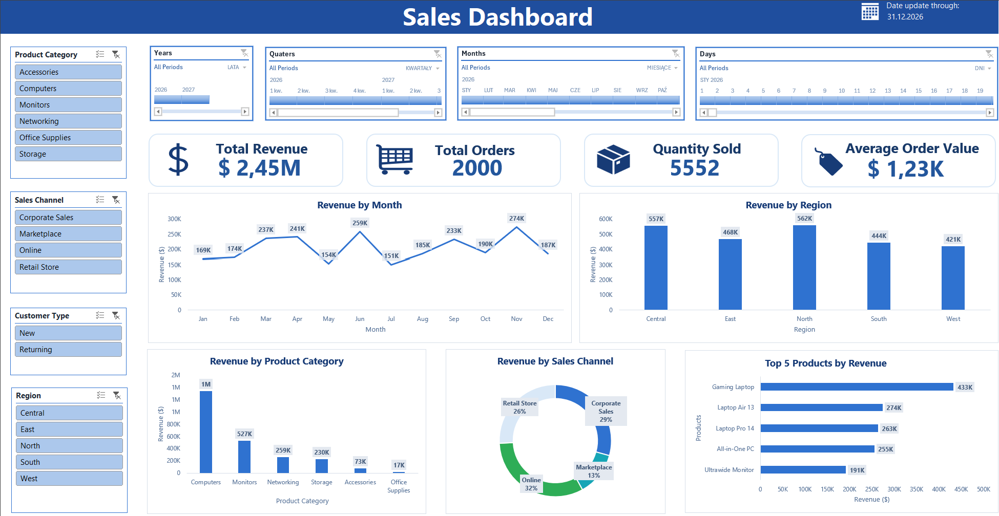

# 📊 Sales Dashboard – Excel
An interactive sales dashboard built in Microsoft Excel using PivotTables, PivotCharts, slicers, and timelines.

## 🎯 Project Goal

The goal of this project was to turn raw sales data (2,000 orders) into a
clear, interactive dashboard that answers key business questions:

- What is the total revenue and how many orders were placed?
- How does revenue change over time?
- Which regions, product categories, and sales channels generate the most
  revenue?
- Which products sell best?

## 📈 Key Metrics (KPIs)

| Metric              | Value  |
| ------------------- | ------ |
| Total Revenue       | $2.45M |
| Total Orders        | 2,000  |
| Quantity Sold       | 5,552  |
| Average Order Value | $1.23K |

## 🔍 Key Insights

- **Top regions:** North (562K) and Central (557K); weakest: West (421K).
- **Top category:** Computers (~1.35M), more than half of total revenue.
  Weakest: Office Supplies (17K).
- **Sales channels:** Online (32%) > Corporate Sales (29%) >
  Retail Store (26%) > Marketplace (13%).
- **Top products:** Gaming Laptop (433K), followed by Laptop Air 13 (274K)
  and Laptop Pro 14 (263K).
- **Seasonality:** highest revenue in November (274K) and June (259K),
  lowest in July (151K) and May (154K).

## 🧩 Dashboard Contents

**KPI cards**
- Total Revenue, Total Orders, Quantity Sold, Average Order Value

**Charts**
- Revenue by Month (line chart)
- Revenue by Region (column chart)
- Revenue by Product Category (column chart)
- Revenue by Sales Channel (donut chart)
- Top 5 Products by Revenue (bar chart)

**Interactive filters**
- Slicers: Product Category, Sales Channel, Customer Type, Region
- Timelines: Years, Quarters, Months, Days

## 🗂️ Data

| Column           | Description                                   |
| ---------------- | --------------------------------------------- |
| Order ID         | Unique order identifier                       |
| Date             | Order date                                    |
| Region           | Sales region                                  |
| Sales Channel    | Sales channel (online, retail, marketplace)   |
| Customer Type    | New or returning customer                     |
| Product Category | Product category                              |
| Product          | Product name                                  |
| Quantity         | Number of units sold                          |
| Unit Price       | Price per unit                                |
| Discount         | Discount applied                              |
| Revenue          | Final sales amount                            |

### ✅ Data Quality Checks

Before building the PivotTables, I verified that:
- there are no blank column headers,
- there are no completely blank rows,
- the Date column is recognized as dates,
- Revenue and Quantity are numeric,
- category and region names are spelled consistently,
- Order ID is available (needed to count orders).

## 🗺️ Business Question → Dashboard Element

| Business Requirement       | Dashboard Element            | Columns Used              |
| -------------------------- | ---------------------------- | ------------------------- |
| Total revenue              | Total Revenue                | Revenue                   |
| Number of orders           | Total Orders                 | Order ID                  |
| Units sold                 | Total Quantity Sold          | Quantity                  |
| Average order value        | Average Order Value          | Revenue                   |
| Monthly trend              | Revenue by Month             | Date, Revenue             |
| Regional performance       | Revenue by Region            | Region, Revenue           |
| Category performance       | Revenue by Product Category  | Product Category, Revenue |
| Sales channel share        | Revenue by Sales Channel     | Sales Channel, Revenue    |
| Best-selling products      | Top 5 Products by Revenue    | Product, Revenue          |

## 🛠️ Tools & Features

- Microsoft Excel
- PivotTables and PivotCharts
- Slicers and Timelines
- One set of filters connected to multiple PivotTables
- Dashboard formatting (KPI cards, color scheme, layout)

## 🚀 How to Use

1. Download `Excel_PivotTable_Dashboard.xlsx`.
2. Open it in Microsoft Excel (2016 or newer recommended).
3. Go to the dashboard sheet and use the slicers and timelines to filter
   the data.
4. The `Supporting PivotTables` sheet contains the PivotTables that power
   the charts.
